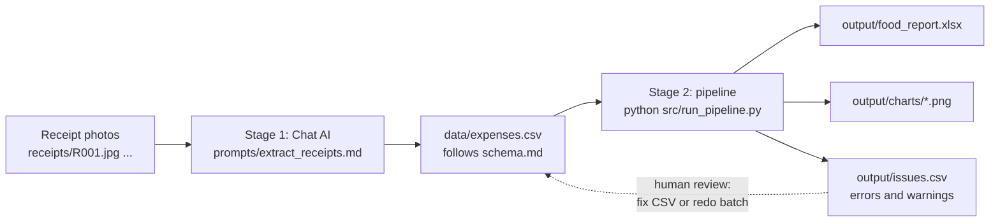

# receipt-expense-pipeline

A two-stage AI workflow that turns photos of US food receipts into a food spending report with charts by restaurant type, cuisine and year.

It chains two different AI UX types:

| Stage | AI UX type | What it does | Output |
|-------|-----------|--------------|--------|
| 1 | **Chat AI** (e.g. ChatGPT) | Reads receipt photos and extracts one CSV row per receipt | `data/expenses.csv` |
| 2 | **IDE AI** (e.g. Claude Code in VS Code) | Built the validation, report and chart code, which runs with one command | `output/` |

The two stages never talk to each other directly. They share one contract, [`schema.md`](schema.md), which defines every column, allowed value and number format in the CSV.

## Workflow



The full step-by-step notes, validation rules and design decisions are in **[docs/workflow.md](docs/workflow.md)**.

## Quick start

**Requirements:** Python 3 and the packages in `requirements.txt`.

```bash
python -m venv venv
venv\Scripts\activate          # Windows (macOS/Linux: source venv/bin/activate)
pip install -r requirements.txt
```

**Stage 1:** follow [prompts/extract_receipts.md](prompts/extract_receipts.md) to extract receipt photos with any vision-capable chat AI, and save the rows to `data/expenses.csv`.

**Stage 2:** run the whole pipeline with one command:

```bash
python src/run_pipeline.py data/expenses.csv
```

It prints a summary like this:

```
Pipeline summary for tests/fixtures/expenses_broken.csv
  Rows read:     11
  Rows kept:     7
  Rows excluded: 4
  Warnings:      13 (on 6 kept rows)
  Files created:
    output\expenses_clean.csv
    output\issues.csv
    output\food_report.xlsx
    output\charts\spend_by_restaurant_type.png
    ...
```

**Tests:**

```bash
python -m pytest tests
```

## What you get in `output/`

| File | Contents |
|------|----------|
| `food_report.xlsx` | Summary, By Restaurant Type, By Cuisine, By Year, Receipts, and Needs Review sheets |
| `charts/*.png` | Spend by restaurant type, spend by cuisine, spend by year, average cost per visit, tip percentage |
| `expenses_clean.csv` | The rows that passed validation, cleaned |
| `issues.csv` | Every error (row excluded) and warning (row kept, needs a look) |

## Project layout

```
receipts/            receipt photos, named R001.jpg, R002.jpg, ...
prompts/             Stage 1 extraction prompt and the Stage 2 build prompts
schema.md            the CSV contract between the two stages
data/expenses.csv    Stage 1 output (never modified by Stage 2)
src/                 validate.py, report.py, charts.py, run_pipeline.py
tests/               pytest tests and a deliberately broken fixture CSV
output/              everything Stage 2 generates
CLAUDE.md            project rules for the IDE AI
docs/workflow.md     full workflow documentation
```
